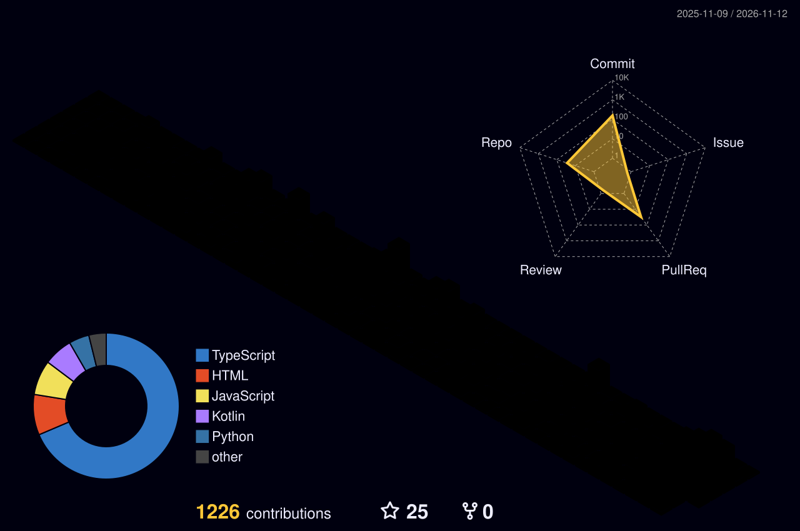

<!-- EP.01 · ORIGIN -->

  

<!-- EP.02 · MY NINJA WAY -->

  

<!-- EP.03 · JUTSU ARSENAL -->

  

<!-- EP.04 · NINJA REGISTRATION -->

 

🔴 Live chakra readings

 

## 🌀 EP.05 // S-Rank Missions

<table>
<tr><th>Mission</th><th>Briefing</th><th>Jutsu</th><th align="center">⭐</th></tr>
<tr><td><a href="https://github.com/Xdev200/coding_panda_blog"><b>Coding Panda</b></a></td><td>Coding Panda</td><td><code>TypeScript</code></td><td align="center"><b>2</b></td></tr>
<tr><td><a href="https://github.com/Xdev200/playstore-gap-finder"><b>Play Store Gap Finder</b></a></td><td>Find Google Play market gaps: high demand, low satisfaction. Weekly SEO reports. No API key.</td><td><code>HTML</code></td><td align="center">0</td></tr>
<tr><td><a href="https://github.com/Xdev200/ConvertPDF-website"><b>ConvertPDF Website</b></a></td><td>ConvertPDF 3D marketing site (Privacy, Terms, Support)</td><td><code>TypeScript</code></td><td align="center">0</td></tr>
<tr><td><a href="https://github.com/Xdev200/star-burst-blaster"><b>Star Burst Blaster</b></a></td><td>A high-octane, neon-drenched cosmic candy arcade journey. This PWA brings the arcade to your pocket with zero downloads required.</td><td><code>HTML</code></td><td align="center">0</td></tr>
<tr><td><a href="https://github.com/Xdev200/smart-office-assistant-web"><b>Smart Office Assistant</b></a></td><td>Smart Office Assistant: Streamline Office Operations</td><td><code>TypeScript</code></td><td align="center">0</td></tr>
<tr><td><a href="https://github.com/Xdev200/Secure_Password_Manager"><b>Secure Password Manager</b></a></td><td>—</td><td><code>HTML</code></td><td align="center"><b>2</b></td></tr>
</table>

<a href="https://github.com/Xdev200?tab=repositories"><b>→ Browse every mission scroll</b></a>

  

## 🍃 EP.06 // Training Grounds

*Each commit trains one more block of the skyline. Redrawn automatically every night.*

  

<!-- EP.07 · JOIN THE SQUAD -->

  

  

**To be continued… the next commit is the next episode.** 🌀

