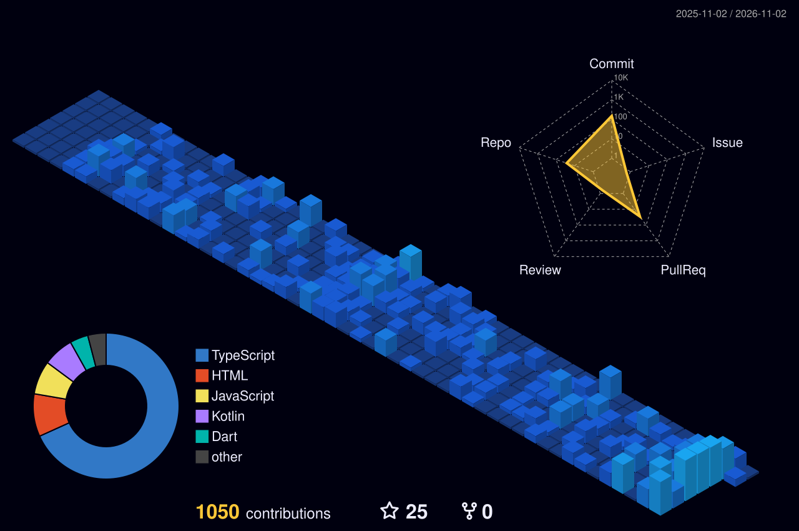

<!-- 🎬 HERO · animated intro -->

  

 

<!-- 🌀 MY NINJA WAY -->

  

<!-- 🔦 JUTSU ARSENAL -->

  

<!-- 🪪 NINJA REGISTRATION + MISSION DASHBOARD -->

  

## 🌀 S-Rank Missions

<table>
<tr><th>Mission</th><th>What it is</th><th>Jutsu used</th><th align="center">⭐</th></tr>
<tr><td><a href="https://github.com/Xdev200/coding_panda_blog"><b>Coding Panda</b></a></td><td>Coding Panda</td><td><code>TypeScript</code></td><td align="center"><b>2</b></td></tr>
<tr><td><a href="https://github.com/Xdev200/playstore-gap-finder"><b>Play Store Gap Finder</b></a></td><td>Find Google Play market gaps: high demand, low satisfaction. Weekly SEO reports. No API key.</td><td><code>HTML</code></td><td align="center">0</td></tr>
<tr><td><a href="https://github.com/Xdev200/ConvertPDF-website"><b>ConvertPDF Website</b></a></td><td>ConvertPDF 3D marketing site (Privacy, Terms, Support)</td><td><code>TypeScript</code></td><td align="center">0</td></tr>
<tr><td><a href="https://github.com/Xdev200/star-burst-blaster"><b>Star Burst Blaster</b></a></td><td>A high-octane, neon-drenched cosmic candy arcade journey. This PWA brings the arcade to your pocket with zero downloads required.</td><td><code>HTML</code> <code>PWA</code></td><td align="center">0</td></tr>
<tr><td><a href="https://github.com/Xdev200/smart-office-assistant-web"><b>Smart Office Assistant</b></a></td><td>Smart Office Assistant: Streamline Office Operations</td><td><code>TypeScript</code></td><td align="center">0</td></tr>
<tr><td><a href="https://github.com/Xdev200/Secure_Password_Manager"><b>Secure Password Manager</b></a></td><td>—</td><td><code>HTML</code></td><td align="center"><b>2</b></td></tr>
</table>

<a href="https://github.com/Xdev200?tab=repositories"><b>→ See all 49 repositories</b></a>

  

### 🌃 My contribution village

*Every commit raises another building, rebuilt automatically every day.*

  

<!-- 💌 JOIN THE SQUAD -->

  

 

**Build it, ship it, repeat: keep coding, keep shipping.** 🌀

